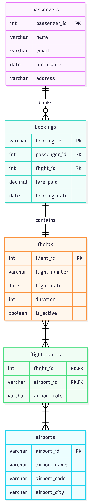

# Airline Booking Analytics

A PostgreSQL project that uses airline booking data to track fares, booking activity, and passenger no-shows.

## Domain

The airline booking system connects passengers, flights, and airports. A booking is the event in this project. Each booking belongs to a passenger and a flight and records when it was made, the fare, and the booking status.

I used the data to answer questions an airline operations team might ask. Which flights have the most bookings? Which flights should we review for no-shows? Did the no-show rate improve over time? I count a no-show when the recorded cancellation reason is `Passenger no show` and divide by all bookings.

## Database overview



The ERD shows my initial design. The queries use the [Unit 3 reference schema and sample data](airline.sql). In that schema, `bookings` holds the fares, booking timestamps, and cancellation reasons. It links to `passengers` and `flights`. The `flight_routes` table connects flights to `airports`, and `flight_services` lists service codes for each flight.

## Query catalogue

### Unit 3 — SQL fundamentals

| Query | Business question |
| --- | --- |
| [3.1](queries/unit3/q3_1.sql) | Which active flights have the largest capacity, and what can we learn from the booking records? |
| [3.2](queries/unit3/q3_2.sql) | How do missing cancellation reasons affect the passenger no-show count? |
| [3.3](queries/unit3/q3_3.sql) | Which passengers have no recorded no-show bookings? |

### Unit 4 — Aggregation

| Query | Business question |
| --- | --- |
| [4.1](queries/unit4/q4_1.sql) | How do booking volume, average fares, and no-show rates vary by flight or booking country? |
| [4.2](queries/unit4/q4_2.sql) | How do no-show rates differ by flight, country, and minimum booking volume? |

### Unit 5 — Joins

| Query | Business question |
| --- | --- |
| [5.1](queries/unit5/q5_1.sql) | Who booked each flight, which flights connect to Changi, and how do flights from the same country compare? |
| [5.2](queries/unit5/q5_2.sql) | Which flights disappear from a report that only includes flights with bookings? |
| [5.3](queries/unit5/q5_3.sql) | How many flight and airport combinations are possible, and how does PostgreSQL plan the booking history join? |

### Unit 6 — Window functions

| Query | Business question |
| --- | --- |
| [6.1](queries/unit6/q6_1.sql) | Which fares differ from their flight average, and what happens when flights tie in the booking leaderboard? |
| [6.2](queries/unit6/q6_2.sql) | How do consecutive fares compare, when did we reach the booking target, and which flights had long booking gaps? |
| [6.3](queries/unit6/q6_3.sql) | What are the three highest fares for each flight, and how did the no-show rate change by month? |

## Technical highlights

- **Conditional aggregation** counts no-shows and all bookings together so both numbers are visible when calculating the rate. [Task 4.2](queries/unit4/q4_2.sql)
- **LEFT JOIN** keeps flights in the report even when they have no bookings. [Task 5.2](queries/unit5/q5_2.sql)
- **Partitioned averages** keep individual bookings visible beside their flight's average fare. [Task 6.1](queries/unit6/q6_1.sql)
- **Common table expressions and window functions** summarize bookings by month before using `LAG` to compare rates. A date check confirms that the previous row is the previous calendar month. [Task 6.3](queries/unit6/q6_3.sql)

## Findings and recommendations

- **Five of 12 no-shows came from two flights.** I would review the three bookings on VN202 and two on VN203 first and check the reminder and check-in records. [Task 4.2](queries/unit4/q4_2.sql)
- **Two active flights had no recorded bookings.** I would check whether VN214 and VN215 were available and whether their booking records are complete before making a decision about demand. [Task 5.2](queries/unit5/q5_2.sql)
- **The no-show rate fell in the second half of 2023, but it still varied by month.** The rate was 6.93% in the first half, 5.05% in the second, and 12.50% in December. I would keep tracking the rate with the underlying counts. [Closing memo](analysis/unit6-finding.md)

## Limitations and future improvements

The sample has 200 bookings and 12 no-shows. A change of one or two bookings can move the monthly rate. I would collect more booking history and add scheduled departure dates so the team can compare no-shows by the month passengers were due to fly.

## Video presentation

Recording link pending.

## How to run it

From the repository root, use PostgreSQL and `psql` to load the reference schema and data into a new database. The load script drops existing tables with the same names.

```sh
createdb ex603_data
psql -d ex603_data -v ON_ERROR_STOP=1 -f airline.sql
psql -d ex603_data -v ON_ERROR_STOP=1 -f queries/unit6/q6_3.sql
```

Task 3.2 includes an intentional alias error followed by two corrected examples.
